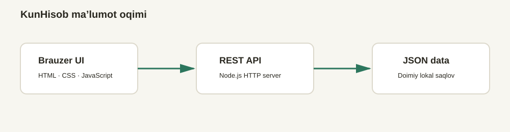

# KunHisob

**Aniqroq kun, xotirjamroq oy.** KunHisob — daromad va xarajatlarni yozib borish, balansni ko‘rish va qaysi kategoriyaga qancha pul ketayotganini tushunish uchun yaratilgan o‘zbekcha full-stack web-ilova.



## Nima muammoni hal qiladi?

Ko‘pchilik oy oxirida pul qayerga ketganini taxmin qiladi, lekin aniq bilmaydi. KunHisob har bir kirim va chiqimni sana, summa, kategoriya va izoh bilan saqlaydi. Dashboard darhol umumiy balansni, jami daromadni, jami xarajatni va xarajatlar taqsimotini ko‘rsatadi.

## Imkoniyatlar

- daromad yoki xarajat qo‘shish;
- summa, sana, kategoriya va izohni saqlash;
- balans, daromad va xarajat summalarini ko‘rish;
- tranzaksiyalarni sana bo‘yicha ko‘rish;
- oy bo‘yicha filterlash;
- xarajatlarni kategoriyalar bo‘yicha progress bar bilan ko‘rish;
- keraksiz yozuvni o‘chirish;
- responsive desktop va mobil interfeys;
- REST API health check va validatsiya.

## Texnologiyalar

| Qism | Texnologiya |
|---|---|
| Frontend | Semantic HTML, CSS, Vanilla JavaScript |
| Backend | Node.js built-in HTTP server |
| Saqlash | JSON fayl (`data/transactions.json`) |
| API | REST, JSON |
| Tekshiruv | Node smoke tests, `node --check` |

Tashqi AI API, framework yoki pullik xizmat kerak emas. Shu sababli loyiha tez ishga tushadi va server ichidagi kodni o‘qish oson.

## Ishga tushirish

```bash
git clone https://github.com/RaximjonRaximov/kunhisob.git
cd kunhisob
cp .env.example .env
npm start
```

Keyin brauzerda `http://localhost:3010` manzilini oching. Node.js 18 yoki undan yuqori versiya kerak. `PORT` orqali portni o‘zgartirish mumkin.

## API

| Method | Endpoint | Vazifasi |
|---|---|---|
| GET | `/api/health` | Server holatini tekshirish |
| GET | `/api/transactions` | Barcha tranzaksiyalarni olish |
| GET | `/api/transactions?month=2026-11` | Tanlangan oy yozuvlarini olish |
| GET | `/api/summary` | Balans va kategoriyalar bo‘yicha jamlanma |
| GET | `/api/categories` | Kategoriya ro‘yxatini olish |
| POST | `/api/transactions` | Yangi yozuv yaratish |
| DELETE | `/api/transactions/:id` | Yozuvni o‘chirish |

POST so‘rovining namunasi:

```json
{
  "title": "Oylik maosh",
  "amount": 8500000,
  "type": "income",
  "category": "Maosh",
  "date": "2026-11-21",
  "note": "Noyabr oyligi"
}
```

`type` qiymati `income` yoki `expense` bo‘lishi kerak. Summa musbat son bo‘lishi, nom va sana kiritilishi shart.

## Tekshiruv buyruqlari

```bash
npm run lint  # server va frontend JavaScript sintaksisi
npm test      # 4 ta smoke test
npm start     # serverni ishga tushirish
```

## Fayllar tuzilmasi

```text
server.js                    # HTTP server va REST API
public/index.html             # dashboard markup va forma
public/style.css              # responsive dizayn
public/app.js                 # API bilan ishlovchi frontend
data/transactions.json        # lokal ma’lumotlar fayli
docs/architecture.svg        # README uchun arxitektura diagrammasi
.env.example                 # sozlamalar namunasi
test.js                      # smoke testlar
```

## Saqlash haqida

MVP versiyada ma’lumotlar JSON faylga yoziladi. Bu kichik shaxsiy foydalanish uchun sodda va shaffof yechim. Ko‘p foydalanuvchili production tizimga o‘tkazishda SQLite yoki PostgreSQL, autentifikatsiya, backup va foydalanuvchi workspace’larini qo‘shish tavsiya qilinadi.

## Litsenziya

MIT
